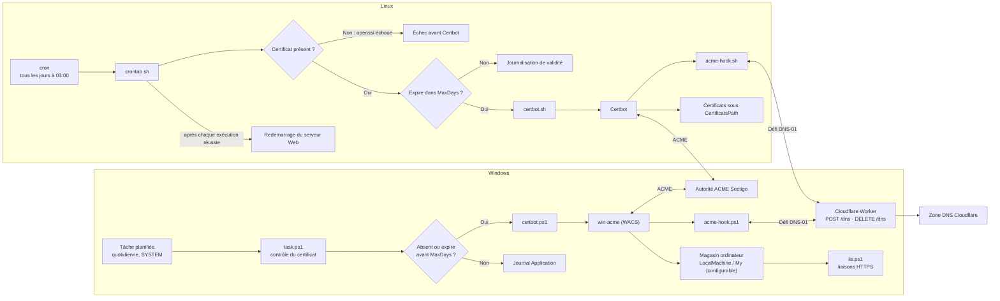

# Sectigo ACME

Automatisation de l'émission et du renouvellement de certificats Sectigo avec un challenge DNS-01. Le dépôt contient deux parcours indépendants : Windows avec win-acme (WACS) et IIS, et Linux avec Certbot et cron. Sous Linux, cron redémarre le serveur Web après chaque exécution réussie du contrôle quotidien.

## Architecture

Les deux plateformes utilisent le même principe : le client ACME demande un challenge DNS-01, un hook délègue la création du TXT à un Cloudflare Worker, puis le certificat est installé sur l'hôte.

Le code du Cloudflare Worker n'est pas inclus dans ce dépôt. Le Worker doit accepter les requêtes `POST /dns` et `DELETE /dns` authentifiées par l'en-tête `X-API-Token`.

## Documentation par plateforme

- [Guide Windows](docs/windows.md) — configuration WACS, magasin Windows, IIS et tâche planifiée.
- [Guide Linux](docs/linux.md) — Certbot, hooks DNS, configuration, secrets et cron.

## Secrets et configuration

Les fichiers de configuration et de secrets propres à chaque hôte sont locaux et ignorés par Git. Utilisez les fichiers `.example` comme modèles, renseignez les secrets sur la machine cible et limitez leurs permissions. Ne publiez jamais les identifiants Sectigo EAB ni le jeton du Worker.

## Historique

Voir le [changelog](CHANGELOGS.md).
