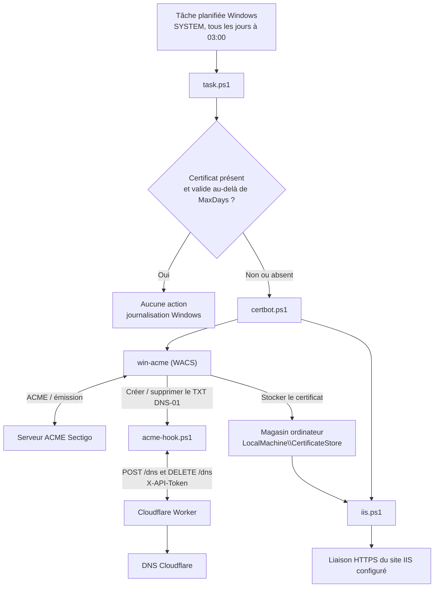

# Sectigo ACME

Automatisation de l'émission et du renouvellement de certificats Sectigo par ACME. La configuration Windows de ce dépôt utilise win-acme (WACS), un challenge DNS-01 délégué à un Cloudflare Worker, le magasin de certificats Windows et la mise à jour d'une liaison HTTPS IIS.

## Architecture Windows

Le Worker Cloudflare est un service externe : son code n'est pas fourni dans ce dépôt. Il doit accepter les requêtes `POST /dns` et `DELETE /dns` envoyées par le hook, authentifiées avec l'en-tête `X-API-Token`.

## Fonctionnement

1. La tâche planifiée lance `task.ps1` quotidiennement. Ce script cherche le certificat correspondant à `WildcardDomains` dans le magasin `LocalMachine\CertificateStore`.
2. Si le certificat est absent, ou s'il expire dans moins de `MaxDays`, `task.ps1` lance `certbot.ps1`. Sinon, il journalise qu'aucun renouvellement n'est requis.
3. `certbot.ps1` exécute WACS contre le serveur ACME Sectigo. WACS demande la création du challenge DNS-01 au hook `acme-hook.ps1`, qui appelle le Worker Cloudflare et attend le délai configuré avant la validation.
4. Après l'émission, WACS enregistre le certificat dans le magasin configuré. `certbot.ps1` lance ensuite `iis.ps1`, qui recherche ce certificat et met à jour toutes les liaisons HTTPS du site IIS configuré en utilisant le même magasin.
5. Les événements de création, de renouvellement, d'absence de certificat et d'erreur sont écrits dans le journal Application de Windows.

La tâche est configurée pour s'exécuter sous le compte `SYSTEM` avec le niveau de privilèges maximal. Exécutez `make-task.ps1` depuis une session PowerShell lancée en tant qu'administrateur afin de créer ou mettre à jour cette tâche. Une exécution manuelle de `task.ps1` doit également se faire dans une session élevée ; WACS doit pouvoir accéder au magasin de certificats de l'ordinateur.

## Prérequis

- Windows avec PowerShell, le module `ScheduledTasks` et le rôle IIS (module `WebAdministration`).
- win-acme (WACS) installé sur le serveur.
- Un compte Sectigo et les identifiants External Account Binding (EAB) nécessaires à votre endpoint ACME.
- Un Cloudflare Worker configuré pour modifier les enregistrements DNS du domaine et un jeton d'API.
- Une liaison HTTPS IIS pour le site ciblé.

## Configuration Windows

1. Copiez `windows/config.ini.example` vers `windows/config.ini` et renseignez les paramètres ci-dessous.
2. Copiez `windows/secrets.ini.example` vers `windows/secrets.ini` et renseignez `EabKid`, `EabHmac` et `ApiToken`.
3. Protégez `config.ini` et `secrets.ini` avec des permissions adaptées au compte qui exécute la tâche. Ces fichiers sont ignorés par Git.
4. Vérifiez que les chemins vers WACS et les scripts correspondent à leur emplacement réel sur le serveur.
5. Depuis une session PowerShell administrateur, exécutez `make-task.ps1`, puis démarrez la tâche planifiée pour vérifier la configuration.

| Paramètre | Rôle |
| --- | --- |
| `ServerUrl` | Endpoint ACME Sectigo utilisé par WACS. |
| `WildcardDomains` | Nom de domaine présenté à l'autorité ACME et utilisé pour rechercher le certificat. |
| `CertificateStore` | Magasin du certificat dans `Cert:\LocalMachine` ; `My` désigne le magasin personnel de l'ordinateur. |
| `WorkerURL` | URL du Worker Cloudflare appelé par le hook DNS. |
| `CoolDownBeforeCheckChallenge` | Délai d'attente, en secondes, après la création du TXT DNS-01. |
| `MaxDays` | Seuil en jours qui déclenche un renouvellement à l'approche de l'expiration. |
| `IISSiteID` | Identifiant du site IIS dont les liaisons HTTPS seront mises à jour. |
| `WACSPath` | Chemin de l'exécutable `wacs.exe`. |
| `TaskPath`, `CertbotPath`, `AcmeHookPath`, `IISScriptPath` | Chemins des scripts utilisés par la tâche et WACS. |
| `TaskName`, `TaskDescription`, `EventSource` | Nom/description de la tâche planifiée et source des événements Windows. |
| `CertificateFriendlyName` | Nom convivial donné au certificat par WACS. |

WACS est sélectionné avec le plugin `certificatestore` ; `CertificateStore` indique séparément le magasin cible. `iis.ps1` transmet également cette valeur à IIS lors de l'association du certificat à la liaison HTTPS.

## Scripts Windows

| Script | Rôle |
| --- | --- |
| `task.ps1` | Vérifie le certificat et décide s'il faut l'émettre/le renouveler. |
| `certbot.ps1` | Configure et lance WACS, puis appelle la mise à jour IIS. |
| `acme-hook.ps1` | Crée ou supprime le challenge TXT via le Worker Cloudflare. |
| `iis.ps1` | Associe le certificat émis à la liaison HTTPS du site configuré. |
| `make-task.ps1` | Crée ou met à jour la tâche planifiée quotidienne. |

## Linux

L'automatisation Linux via Certbot fait partie de l'objectif du projet, mais les scripts et la procédure Linux ne sont pas encore présents dans ce dépôt.

## Historique

Voir [CHANGELOGS.md](./CHANGELOGS.md).
